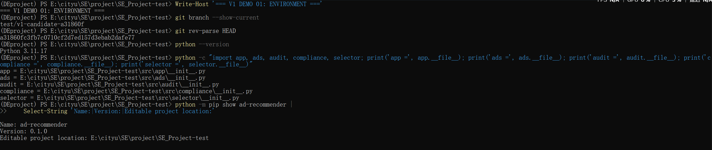
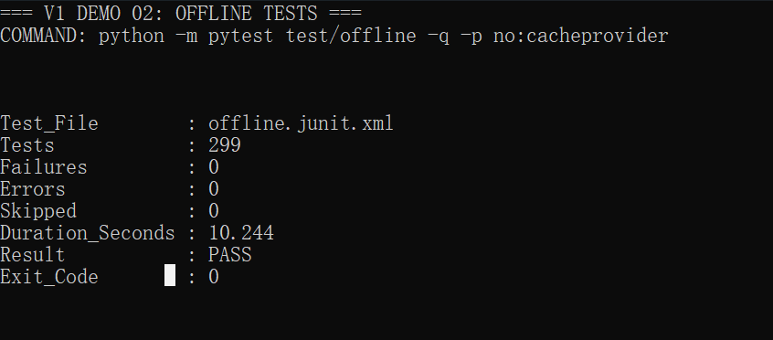
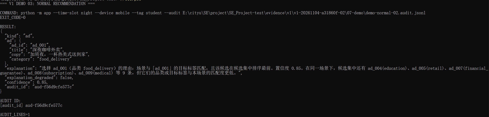
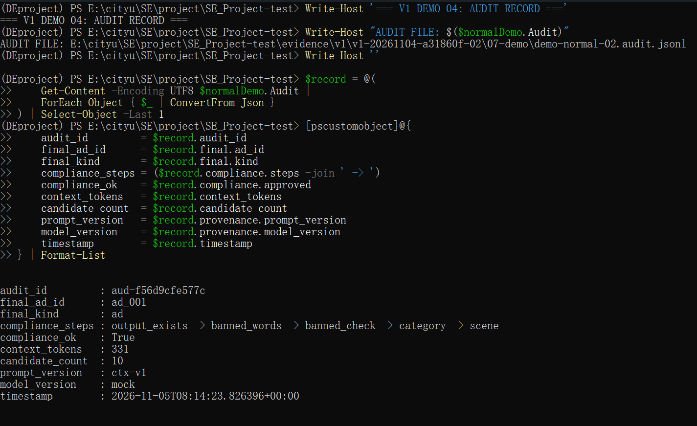
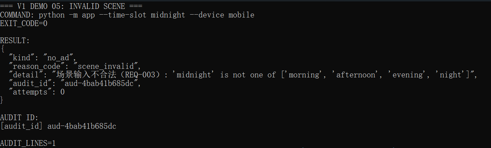
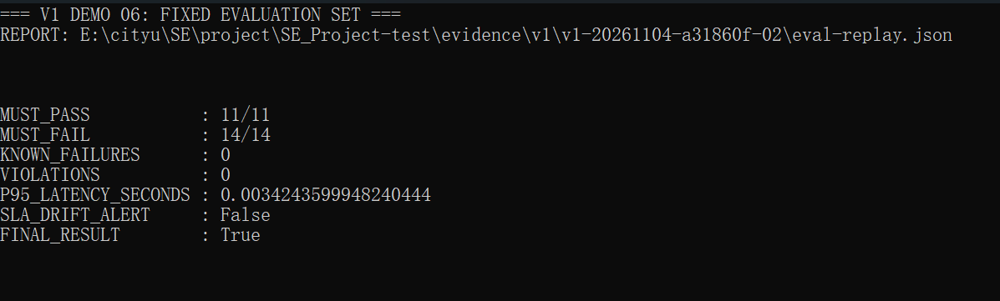
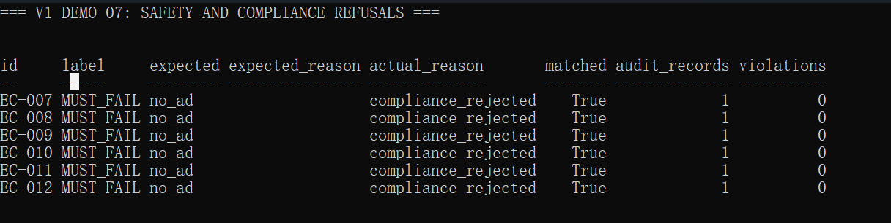
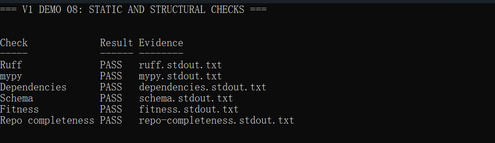
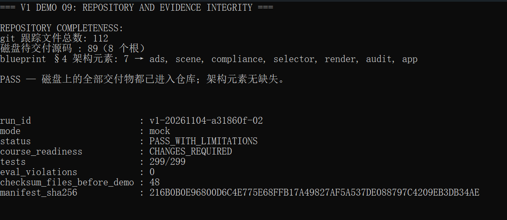
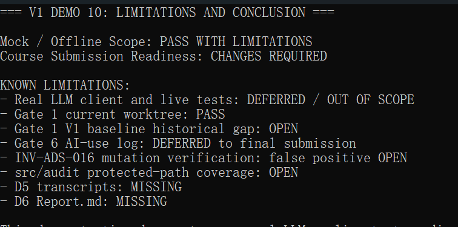

# CS5351 V1 Mock / Offline 截图演示

## 1. 演示信息

- 项目：场景化广告推荐引擎
- 版本：V1
- Commit：`a31860fc3fb7c0710cf2d7ed157d3ebab2dafe77`
- 运行 ID：`v1-20261104-a31860f-02`
- 测试模式：Mock
- 演示日期：2026-11-05

## 2. 演示范围

本演示仅覆盖 V1 Mock / Offline 范围，不包含真实 LLM API、live 测试和真实模型语义质量。

## 3. 截图与命令

### 图 1：环境与源码绑定

- 命令脚本：[01-environment.ps1](../../evidence/v1/v1-20261104-a31860f-02/07-demo/commands/01-environment.ps1)
- 确认项：commit、Python 3.11.17、源码来自 `SE_Project-test\src`。

### 图 2：299 个离线测试

- 命令脚本：[02-offline-tests.ps1](../../evidence/v1/v1-20261104-a31860f-02/07-demo/commands/02-offline-tests.ps1)
- 结果：299 个测试、0 failures、0 errors，结论 PASS。

### 图 3：正常推荐

- 命令脚本：[03-normal-recommendation.ps1](../../evidence/v1/v1-20261104-a31860f-02/07-demo/commands/03-normal-recommendation.ps1)
- 场景：`night / mobile / student`
- 结果：`kind=ad`、`ad_id=ad_001`，生成审计 ID。

### 图 4：审计记录

- 命令脚本：[04-audit-record.ps1](../../evidence/v1/v1-20261104-a31860f-02/07-demo/commands/04-audit-record.ps1)
- 确认项：provenance、候选数、上下文 token、五步合规和最终裁决。
- 合规步骤：`output_exists -> banned_words -> banned_check -> category -> scene`

### 图 5：非法场景降级

- 命令脚本：[05-invalid-scene.ps1](../../evidence/v1/v1-20261104-a31860f-02/07-demo/commands/05-invalid-scene.ps1)
- 场景：`time_slot=midnight`
- 结果：`kind=no_ad`、`reason_code=scene_invalid`、`attempts=0`、审计 1 条。

### 图 6：固定评估集

- 命令脚本：[06-eval-summary.ps1](../../evidence/v1/v1-20261104-a31860f-02/07-demo/commands/06-eval-summary.ps1)
- 结果：MUST_PASS 11/11，MUST_FAIL 14/14，违规 0。

### 图 7：安全与合规拒绝

- 命令脚本：[07-safety-refusals.ps1](../../evidence/v1/v1-20261104-a31860f-02/07-demo/commands/07-safety-refusals.ps1)
- 覆盖：医疗、金融、成人、banned、pending、夜间 gaming。
- 结果：全部 `matched=True`，每条请求审计 1 条，违规 0。

### 图 8：静态与结构检查

- 命令脚本：[08-static-checks.ps1](../../evidence/v1/v1-20261104-a31860f-02/07-demo/commands/08-static-checks.ps1)
- 覆盖：Ruff、mypy、依赖、Schema、fitness、仓库完整性。

### 图 9：仓库与证据完整性

- 命令脚本：[09-evidence-integrity.ps1](../../evidence/v1/v1-20261104-a31860f-02/07-demo/commands/09-evidence-integrity.ps1)
- 展示：仓库完整性 PASS、manifest、SHA-256。
- 注意：截图中 checksum 数量是加入本轮演示文件之前的 48 个。

### 图 10：限制与结论

- 命令脚本：[10-limitations.ps1](../../evidence/v1/v1-20261104-a31860f-02/07-demo/commands/10-limitations.ps1)
- Mock / Offline：PASS WITH LIMITATIONS
- 完整课程 V1：CHANGES REQUIRED

## 4. 结论

截图与命令脚本共同证明 V1 的确定性离线推荐、安全拒绝、降级、审计和测试证据可复现。

本演示不等同于真实 AI/live 验收，也不能消除 Gate 1 历史缺口、Gate 6 延期、变异工具假阳性以及受保护路径覆盖问题。