# CS5351 V2 截图演示

## 1. 演示信息

- 版本：V2
- 测试代码 Commit：`e1711d641077ad9be29ad44bde1580d5d8b219d5`
- 证据快照 Commit：`00fc22d0aa6587258e25c8fddbe3996bb36dd81f`
- Run ID：`v2-20261118-e1711d6-01`
- 环境：Conda `SEProjectV2`
- Python：3.11.18
- 演示日期：2026-11-18

## 2. 演示范围

覆盖 V2 确定性竞价、预算结算、幂等、事务、安全边界、审计、固定评估、V1 回归、Live smoke、p95、token 和成本估算。

不覆盖 human-labeled Live semantic quality、真实支付或曝光，以及远程 CI/branch protection 的实际结果。

## 3. 截图与命令

### 图 1：环境与源码绑定

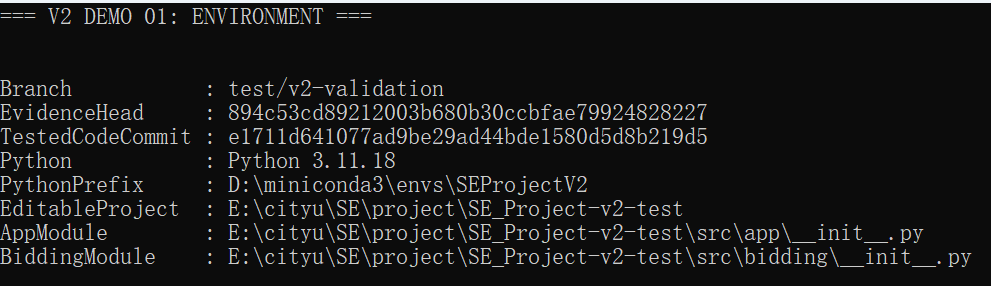

- 命令：[01-environment.ps1](../../evidence/v2/v2-20261118-e1711d6-01/07-demo/commands/01-environment.ps1)
- 确认：V2 分支、测试代码 commit、Python 3.11.18、`SEProjectV2`、editable location 和 bidding 模块路径。

### 图 2：617 个离线测试

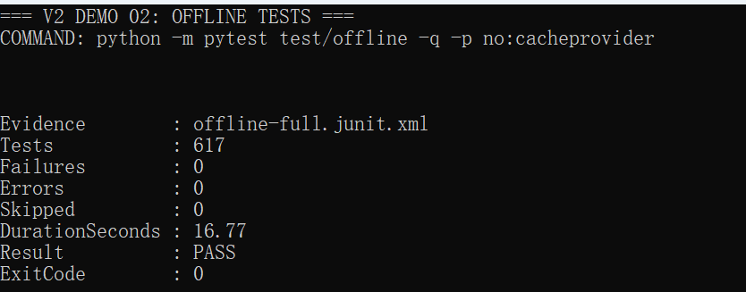

- 命令：[02-offline-tests.ps1](../../evidence/v2/v2-20261118-e1711d6-01/07-demo/commands/02-offline-tests.ps1)
- 证据：`offline-full.junit.xml`
- 结果：617 tests、0 failures、0 errors、0 skipped、PASS。

### 图 3：七场景 V2 演示

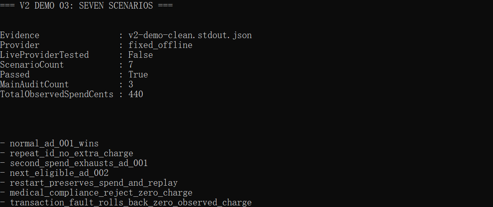

- 命令：[03-v2-demo-summary.ps1](../../evidence/v2/v2-20261118-e1711d6-01/07-demo/commands/03-v2-demo-summary.ps1)
- 结果：7 scenarios、PASS、审计 3 条、总花费 440 分。

### 图 4：幂等、预算和 exhausted

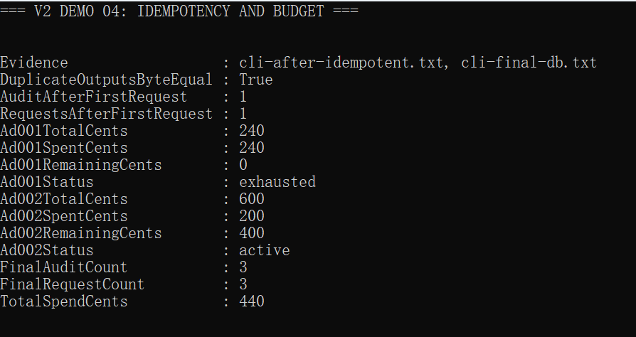

- 命令：[04-cli-idempotency-budget.ps1](../../evidence/v2/v2-20261118-e1711d6-01/07-demo/commands/04-cli-idempotency-budget.ps1)
- 结果：重放输出一致；`ad_001` spent=240、remaining=0、exhausted；`ad_002` spent=200；最终 audit=3、requests=3。

### 图 5：V1/V2 固定 replay

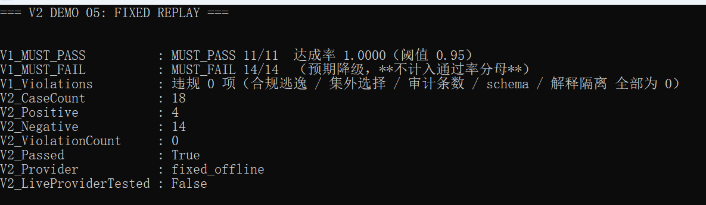

- 命令：[05-replay.ps1](../../evidence/v2/v2-20261118-e1711d6-01/07-demo/commands/05-replay.ps1)
- V1：MUST_PASS 11/11、MUST_FAIL 14/14、违规 0。
- V2：18 cases、违规 0、PASS；provider=fixed_offline。

### 图 6：安全与结算边界

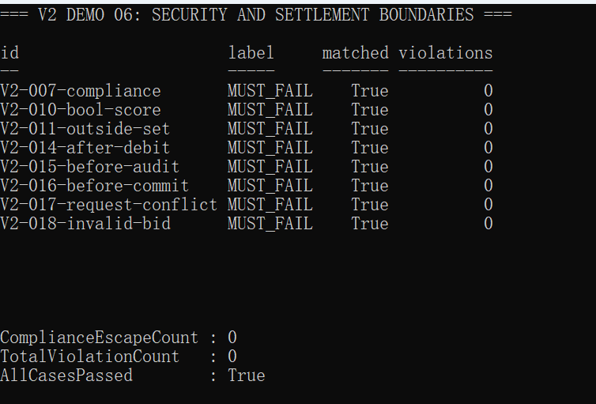

- 命令：[06-security-settlement.ps1](../../evidence/v2/v2-20261118-e1711d6-01/07-demo/commands/06-security-settlement.ps1)
- 覆盖医疗拒绝、bool score、候选集外、三个事务故障点、request conflict 和非法 bid。
- 结果：关键用例 matched=True、violations=0、compliance_escape_count=0。

### 图 7：覆盖率、性能和变异验证

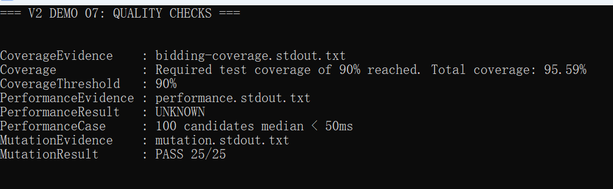

- 命令：[07-quality-checks.ps1](../../evidence/v2/v2-20261118-e1711d6-01/07-demo/commands/07-quality-checks.ps1)
- Bidding coverage：95.59%，门槛 90%。
- 100 候选性能：PASS，中位数低于 50ms。
- 变异验证：25/25 PASS。

### 图 8：Live 正常成交与幂等重放

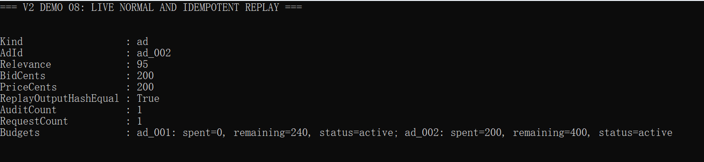

- 命令：[08-live-normal.ps1](../../evidence/v2/v2-20261118-e1711d6-01/07-demo/commands/08-live-normal.ps1)
- 结果：`ad_002`、relevance=95、price=200；重放 Hash 一致；audit=1、request=1。

### 图 9：Live 拒绝路径

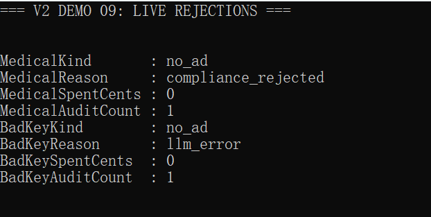

- 命令：[09-live-rejections.ps1](../../evidence/v2/v2-20261118-e1711d6-01/07-demo/commands/09-live-rejections.ps1)
- 医疗：`no_ad/compliance_rejected`，spent=0、audit=1。
- 错误 key：`no_ad/llm_error`，spent=0、audit=1。

### 图 10：Live p95、token 和成本

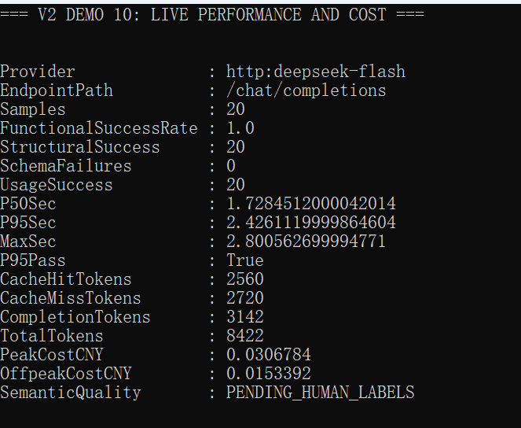

- 命令：[10-live-performance-cost.ps1](../../evidence/v2/v2-20261118-e1711d6-01/07-demo/commands/10-live-performance-cost.ps1)
- 20 samples，functional/structural/usage 均 20/20。
- p50=1.728s、p95=2.426s、max=2.801s，P95 PASS。
- 8,422 tokens；高峰成本 0.0306784 CNY；空闲成本 0.0153392 CNY。
- semantic quality=PENDING HUMAN LABELS。

### 图 11：Gate、限制和结论

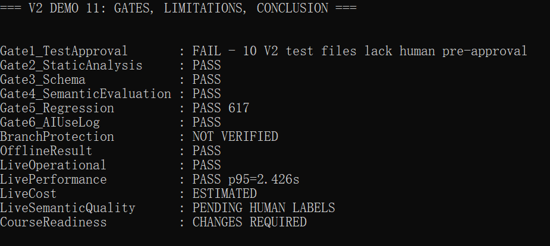

- 命令：[11-gates-limitations.ps1](../../evidence/v2/v2-20261118-e1711d6-01/07-demo/commands/11-gates-limitations.ps1)
- Gate 2/3/4/5/6 PASS；Gate 1 FAIL；branch protection NOT VERIFIED。
- Governance 和 Course Readiness 均为 CHANGES REQUIRED。

## 4. 结论

```text
V2 Offline: PASS
V2 Live Operational: PASS
V2 Live Performance: PASS
V2 Live Cost: ESTIMATED
V2 Live Semantic Quality: PENDING HUMAN LABELS
V2 Governance: CHANGES REQUIRED