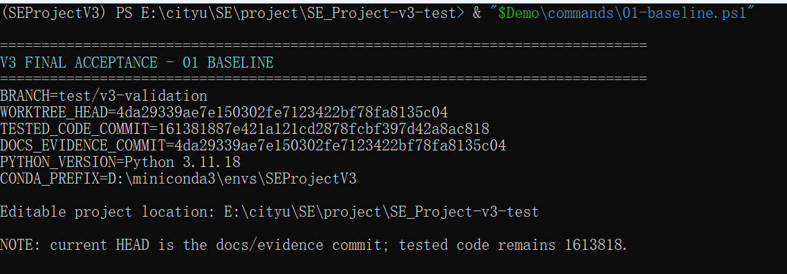
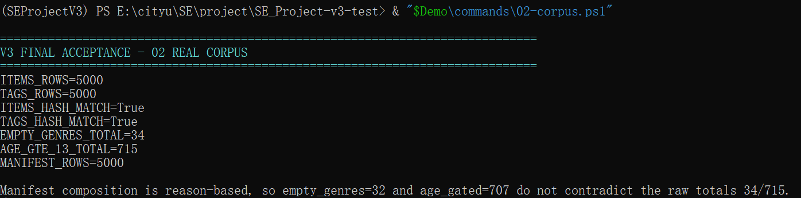
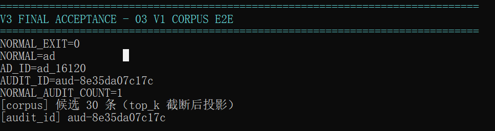
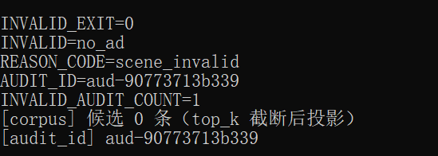
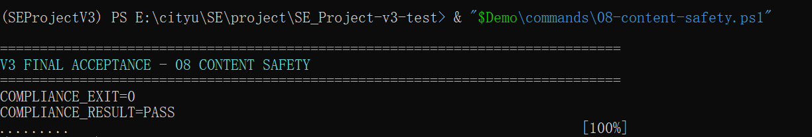
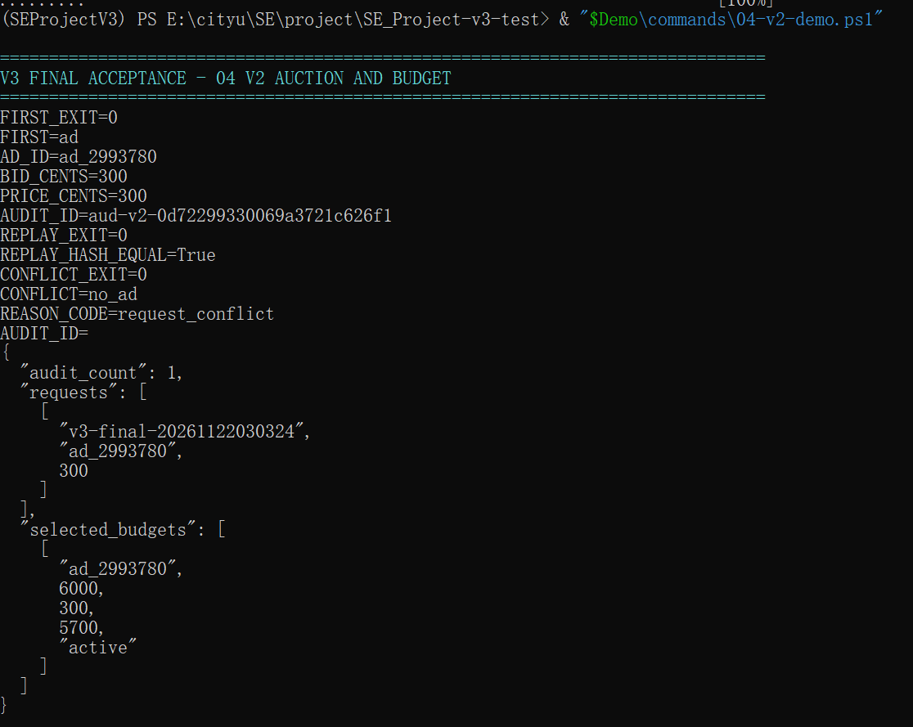
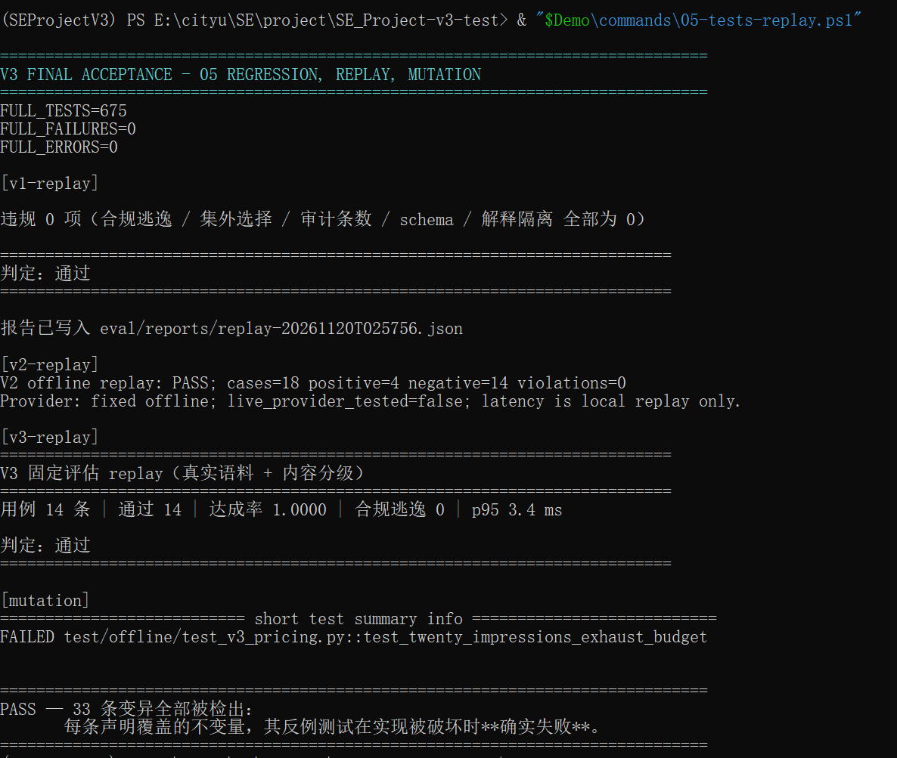
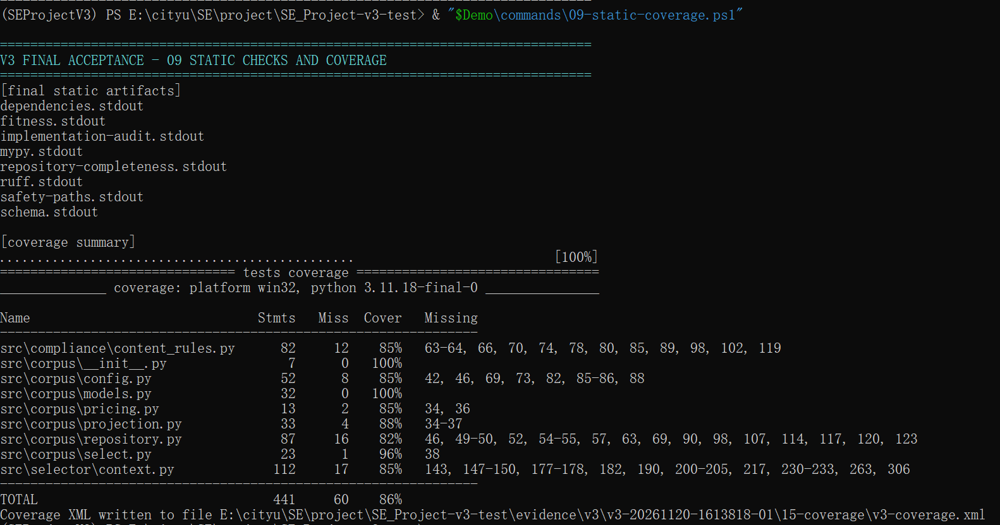
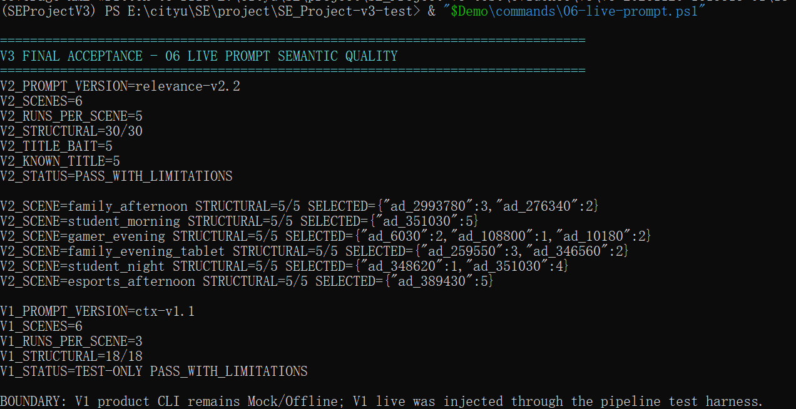
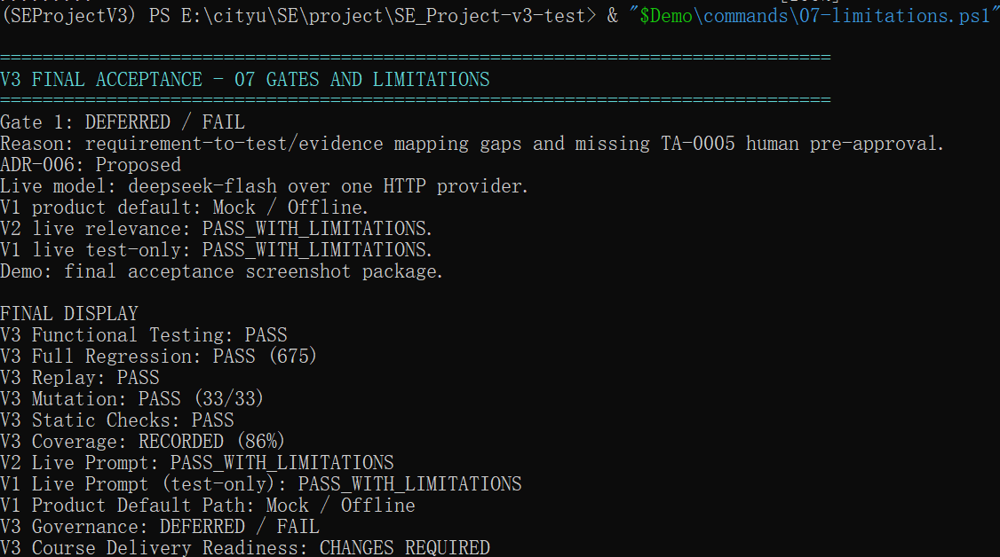

# CS5351 V3 Screenshot Demo

> Status: SCREENSHOT_CAPTURE_COMPLETE（10/10）/ EVIDENCE_COMPLETE
> Run ID: `v3-20261120-1613818-01`
> Tested code commit: `161381887e421a121cd2878fcbf397d42a8ac818`
> Screenshot directory: `evidence/v3/v3-20261120-1613818-01/17-final-demo/screenshots/`

## Screenshot Map

| Screenshot | Command / Evidence | Expected |
|---|---|---|
| `01-environment.png` | `01-baseline.ps1` | branch, tested code commit, docs commit, Python and editable path |
| `02-corpus.png` | `02-corpus.ps1` | 5,000 / 5,000 rows, hash match, 34 / 715 boundary totals |
| `03-v1-normal.png` | `03-v1-demo.ps1` normal portion | `kind=ad`, `ad_16120`, candidate 30, audit 1 |
| `04-v1-invalid.png` | `03-v1-demo.ps1` invalid portion | `no_ad/scene_invalid`, audit 1 |
| `05-content-safety.png` | `08-content-safety.ps1` | `test_v3_compliance.py` PASS |
| `06-v2-auction-budget.png` | `04-v2-demo.ps1` | auction, hash equal, request_conflict, ledger totals |
| `07-regression-replay-mutation.png` | `05-tests-replay.ps1` | 675 tests, V1/V2/V3 replay, mutation 33/33 |
| `08-static-coverage.png` | `09-static-coverage.ps1` | 8 static checks and 86% coverage |
| `09-live-prompt.png` | `06-live-prompt.ps1` | V2 30/30 / V1 test-only 18/18 |
| `10-gates-limitations.png` | `07-limitations.ps1` | Gate 1 DEFERRED/FAIL and final conclusion |

## Captured Images





















## Capture Notes

- Final captures use a readable terminal font and a 1920×1080 window.
- Each image contains one section title and its key result.
- No API key, Authorization header or credential value is visible.
- V1 is marked as product `Mock / Offline`, V1 live is marked `test-only`, and Gate 1 is marked `DEFERRED / FAIL`.

## Evidence Package

The current evidence run root contains:

- `README.md`
- `run-manifest.json`
- `checksums.sha256`

Verify from `evidence/v3/v3-20261120-1613818-01/`:

```powershell
$bad = Get-Content .\checksums.sha256 | ForEach-Object {
    $hash, $path = $_ -split '\s{2}', 2
    if ((Get-FileHash -Algorithm SHA256 -LiteralPath $path).Hash.ToLower() -ne $hash) { $path }
}
if ($bad) { $bad } else { 'CHECKSUMS_OK' }
```
